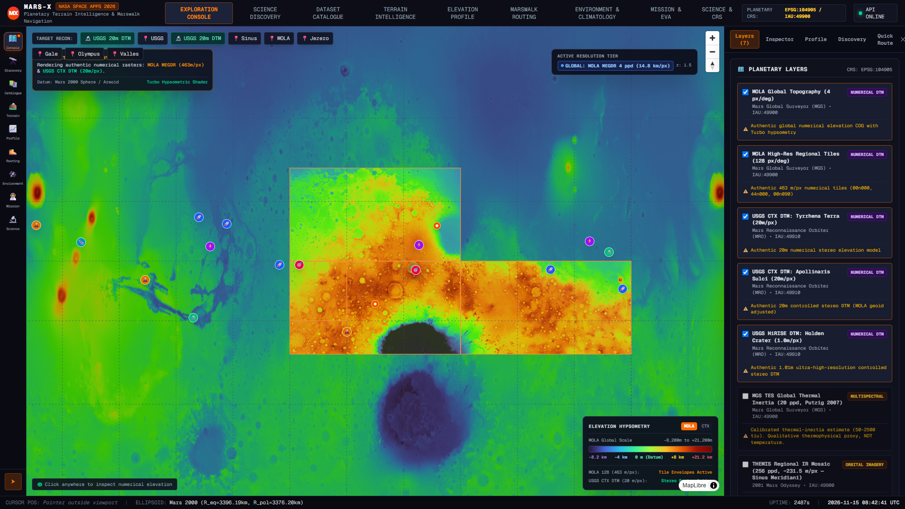
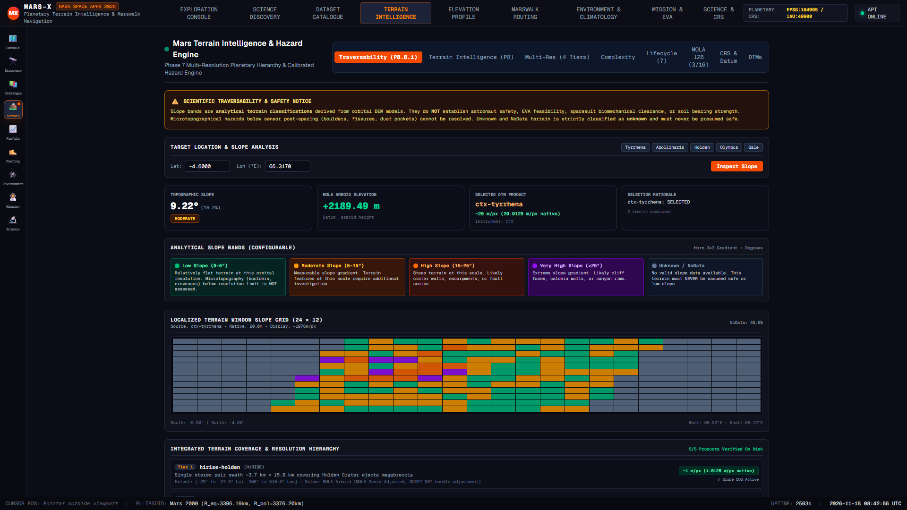
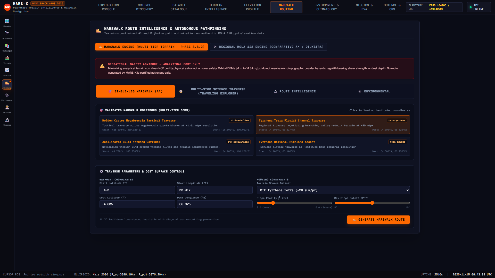
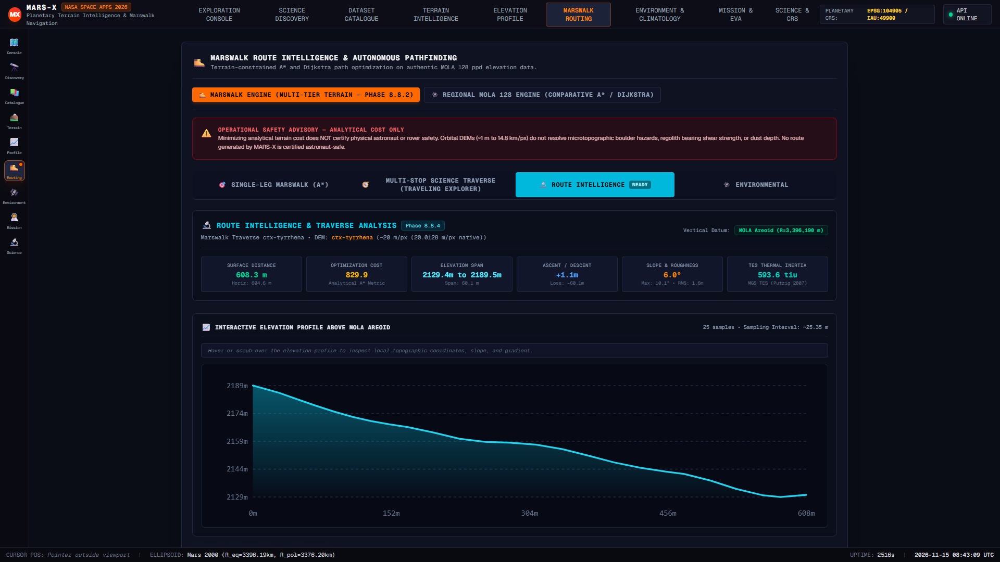
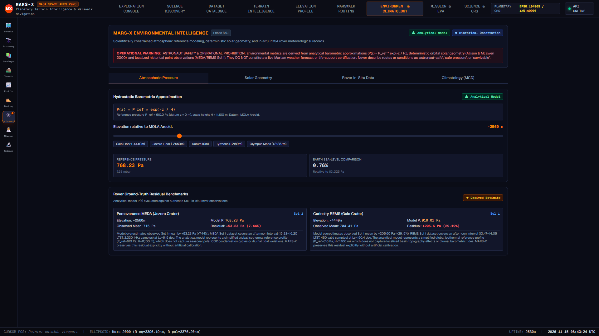
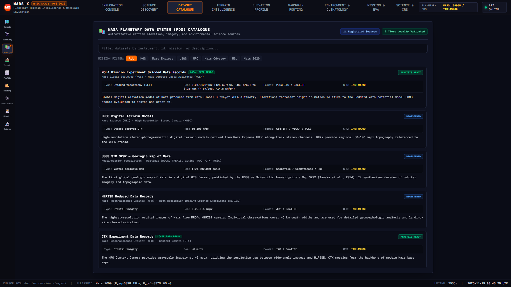
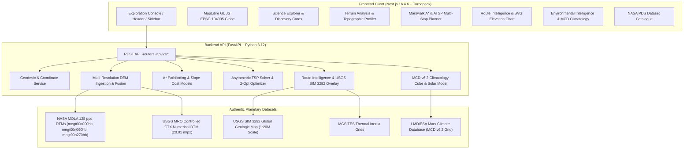

# 🔴 MARS-X — Interplanetary Survival Guide: Martian Map

**Planetary Geospatial Intelligence, Multi-Stop Science Traverse Optimization & Mars Climatology Engine**

[](https://www.spaceappschallenge.org/)
[](https://www.python.org/)
[](https://fastapi.tiangolo.com/)
[](https://nextjs.org/)
[](https://maplibre.org/)
[-crimson.svg)](https://epsg.io/104905)
[-success.svg)](backend/tests/)

> **NASA Space Apps Challenge 2026 Submission**  
> **Challenge Track:** *Interplanetary Survival Guide: Martian Map*  
> **Workspace:** `E:\MARS-X` · **Branch:** `master`

---

> [!CAUTION]
> ### ⚠️ OPERATIONAL SAFETY PROHIBITION & SCIENTIFIC DISCLAIMER
> **MARS-X is an educational, scientific research, and mission-simulation platform.**
> - **NO CERTIFIED ASTRONAUT SAFETY:** No route, traverse, slope calculation, hazard score, or traversability output produced by MARS-X is certified safe for human Extravehicular Activity (EVA) or robotic traversal. Orbital digital elevation models ($463\text{ m/px}$ MOLA, $20\text{ m/px}$ CTX) do not resolve sub-metre boulders, crevices, soft dust pockets, or mechanical hazards.
> - **NO LIVE MARTIAN WEATHER FORECASTING:** Climatological and atmospheric outputs represent analytical reference approximations and multi-year statistical means (MCD v6.2), not live tactical weather forecasting or dust storm warnings.

---

## 🌌 Overview & Mission

Exploring the surface of Mars presents extreme hazards: rugged crater rims, steep volcanic scarps, treacherous loose regolith, bone-chilling diurnal temperature drops, and a whisper-thin $CO_2$ atmosphere with variable dust opacity.

**MARS-X** transforms raw orbital and in-situ planetary datasets into an interactive, scientifically defensible exploration console for the red planet. Combining authentic NASA, ESA, and USGS Mars mission data with high-performance geospatial algorithms, MARS-X empowers researchers, mission planners, and students to:
1. **Explore the Martian Surface in 3D:** Interactive planetary globe rendered in MapLibre GL JS with custom EPSG:104905 areocentric coordinates.
2. **Profile Multi-Resolution Terrain:** Fused elevation data from MGS MOLA (128 ppd, $463\text{ m/px}$) and MRO CTX ($20.01\text{ m/px}$) with bitwise Float32 accuracy.
3. **Assess Surface Hazards:** Horn gradient slope calculations, metric relief, and roughness thresholds to delineate traversable corridors.
4. **Plan Science Traverses:** Admissible A* geodesic routing and Asymmetric Traveling Salesperson Problem (ATSP) multi-stop optimization for visiting high-priority science targets.
5. **Analyze Route Intelligence:** Automated intersection of routes with USGS SIM 3292 1:20M geological formations, MGS TES thermal inertia, and candidate science discoveries.
6. **Query Mars Climatology:** 4D multi-linear environmental interpolation across solar longitude ($L_s$), Martian latitude, longitude, and local true solar time (LTST) powered by the Mars Climate Database (MCD v6.2).

---

## 📸 Application Gallery

| Exploration Console | Science Discovery Suite |
|:---:|:---:|
| [](submission/screenshots/01_exploration_console.png) | [](submission/screenshots/02_science_discovery.png) |
| *Interactive 3D Mars globe with coordinate inspector & layers* | *Candidate discoveries catalog with geological context* |

| Terrain Intelligence | Marswalk Routing & Pathfinding |
|:---:|:---:|
| [](submission/screenshots/03_terrain_intelligence.png) | [](submission/screenshots/04_marswalk_routing.png) |
| *Multi-scale topographic profiling, slope & hazard metrics* | *Terrain-constrained A\* pathfinding on authentic MOLA 128 ppd* |

| Route Intelligence & Traverse Analysis | Environmental Intelligence & Climatology |
|:---:|:---:|
| [](submission/screenshots/05_route_intelligence.png) | [](submission/screenshots/06_environmental_climatology.png) |
| *Elevation profile chart, USGS SIM 3292 geology, & TES thermal inertia* | *MCD v6.2 seasonal & diurnal atmosphere, pressure, & solar irradiance* |

<p align="center">
  <a href="submission/screenshots/07_dataset_catalogue.png">
    
  </a>
  <br />
  <em>NASA PDS and ESA PSA Planetary Science Dataset Catalogue</em>
</p>

---

## 🛠️ Architecture & Technology Stack



### Key Technologies
- **Backend:** FastAPI, Python 3.12, Rasterio, NumPy, Pydantic v2, Uvicorn.
- **Frontend:** Next.js 16.4.6 (App Router + Turbopack), TypeScript, Tailwind CSS, Lucide React, MapLibre GL JS.
- **Geodesics:** IAU 2000 Mars spherical arc-length geodesics ($R = 3,396,190.0\text{ m}$), Vincenty / Haversine distance computations.
- **Testing:** pytest with 485 automated tests passing with 0 failures in 304s.

---

## 🔬 Core Scientific Capabilities

### 1. Multi-Resolution Topographic Ingestion & Geodetic Alignment
- **MOLA MEGDR 128 ppd:** Regional coverage spanning Tyrrhena Terra (`megt00n000hb.img`), Apollinaris Patera (`megt00n090hb.img`), and Holden Crater (`megt00n270hb.img`), covering 26.05% of the Martian sphere.
- **Controlled MRO CTX DTM:** $20.01\text{ m/pixel}$ digital terrain model registered with zero-median boundary continuity ($0.0\text{ m}$) against the MOLA geodetic datum.
- **Bitwise Precision Preservation:** Verified bit-for-bit against IEEE 754 Float32 benchmarks:
  - Tyrrhena DTM Origin: `0x4508d7c3` ($+2,189.4851\text{ m}$)
  - Apollinaris DTM Origin: `0xc5372c4c` ($-2,930.7686\text{ m}$)
  - Holden DTM Origin: `0xc48d849f` ($-1,132.1444\text{ m}$)

### 2. Terrain Hazard & Traversability Analysis
- **Horn Gradient Slope Estimation:** Directional slope gradient computation on spherical raster cells.
- **Metric Relief & Local Roughness:** $O(1)$ integral-image box-filtering for rapidly computing roughness across arbitrary physical window sizes.
- **Traversability Scoring:** Multi-factor cost penalization for slopes exceeding $15^\circ$ with hard-cutoff boundaries at $25^\circ$.

### 3. Marswalk Routing & Traveling Explorer Optimization
- **Directed Asymmetric Cost Matrix:** Path costs depend on travel direction because ascending a slope incurs higher physical energy penalties than descending:
  $$C(A, B) \neq C(B, A)$$
- **Admissible A\* Pathfinding:** Euclidean lower bound on spherical arc-length guarantees mathematical admissibility and optimality.
- **Traveling Explorer Multi-Stop Planner:** Solves science traversal routes:
  - **Exact Permutation Solver ($N \le 8$):** Exhaustive search across $N!$ factorial permutations.
  - **Directed 2-Opt Heuristic ($N > 8$):** Asymmetric edge-reversal algorithm with asymmetric cost re-evaluation.
  - **Optional Stop Prioritization:** Automatically selects top candidate stops within designated science travel budgets.

### 4. Route Intelligence & Scientific Synthesis
- **USGS SIM 3292 1:20M Geology Overlay:** Identifies geological unit intersections (e.g. Amazonian/Hesperian volcanic vs. Noachian highland cratered units) along every traverse leg.
- **MGS TES Thermal Inertia:** Samples thermophysical inertia ($J\,\text{m}^{-2}\,\text{K}^{-1}\,\text{s}^{-1/2}$) to characterize regolith grain size and surface crust induration.
- **Science Opportunity Buffering:** Automatically retrieves candidate science discoveries within customizable lateral corridor envelopes (e.g., $1.0\text{ km}$ buffer).

### 5. Environmental Intelligence & Mars Climatology
- **Analytical Barometric Reference:** Configurable reference pressure model:
  $$P(z) = P_{\text{ref}} \exp\left(-\frac{z}{H}\right) \quad (P_{\text{ref}} = 610\text{ Pa},\; H = 11.1\text{ km})$$
- **Solar Irradiance Distinction:** Strict mathematical separation of:
  - **Normal-Incidence Irradiance:** $F_{\text{normal}} = S_{\text{Mars}} = S_0 / r^2$ ($S_0 = 1361\text{ W/m}^2$, $r \in [1.381, 1.666]\text{ AU}$).
  - **Direct Horizontal Irradiance:** $F_{\text{horizontal}} = S_{\text{Mars}} \max(0, \cos(\text{SZA}))$.
- **4D Climatology Cube (MCD v6.2):** Multi-linear interpolation over $(L_s, \text{lat}, \text{lon}, \text{LTST})$ providing surface pressure, atmospheric temperature, atmospheric density, dust optical depth ($\tau$), and wind vectors.

---

## 🚀 Quick Start & Setup

### Prerequisites
- **Python 3.12+** (ensure `python` or `py` is on PATH)
- **Node.js 18+** / **npm 9+**
- **Git**

### 1. Clone the Repository
```powershell
git clone https://github.com/YourRepo/MARS-X.git
cd MARS-X
```

### 2. Backend Setup
```powershell
cd backend
python -m venv .venv
.venv\Scripts\activate
pip install -r requirements.txt
uvicorn app.main:app --host 127.0.0.1 --port 8000
```
- **Health Check:** `http://127.0.0.1:8000/health`
- **Swagger Documentation:** `http://127.0.0.1:8000/docs`

### 3. Frontend Setup
In a new terminal:
```powershell
cd frontend
npm install
npm run build
npm run start -- -p 3005
```
- **Live Application:** `http://localhost:3005`

### 4. Direct View Deep-Links
| View | Deep-Link URL |
|---|---|
| **Exploration Console** | `http://localhost:3005/?tab=dashboard` |
| **Science Discovery** | `http://localhost:3005/?tab=discovery` |
| **Terrain Intelligence** | `http://localhost:3005/?tab=terrain` |
| **Marswalk Routing** | `http://localhost:3005/?tab=route` |
| **Route Intelligence** | `http://localhost:3005/?tab=route&mode=intelligence&autoPlan=1` |
| **Environmental Climatology** | `http://localhost:3005/?tab=environmental` |
| **Dataset Catalogue** | `http://localhost:3005/?tab=catalogue` |
| **Great-Circle Elevation Profile** | `http://localhost:3005/?tab=profile` |
| **Planetary CRS & Provenance** | `http://localhost:3005/?tab=provenance` |

---

## 🧪 Testing & Verification

Execute the complete automated test suite:

```powershell
# Run climatology tests (Phase 8.9.2)
backend\.venv\Scripts\pytest.exe backend/tests/test_climatology.py

# Run solar & atmospheric model integrity tests (Phase 8.9.1.1)
backend\.venv\Scripts\pytest.exe backend/tests/test_environmental_models.py

# Run the complete regression test suite (485 tests)
backend\.venv\Scripts\pytest.exe backend/tests/
```

**Results:**
```
====================== 485 passed in 304.83s (0:05:04) =======================
```

---

## 📂 Project Structure

```
MARS-X/
├── backend/                       # FastAPI backend
│   ├── app/
│   │   ├── main.py                # FastAPI entry point & middleware
│   │   ├── config.py              # Environment configuration
│   │   ├── routers/               # Modular API routers
│   │   │   ├── science.py         # Elevation & terrain profiling
│   │   │   ├── marswalk.py        # Single-leg & multi-stop A* routing
│   │   │   ├── route_intelligence.py # Geological & thermal route analysis
│   │   │   ├── environmental.py   # Climatology & atmospheric models
│   │   │   └── datasets.py        # NASA PDS dataset catalogue
│   │   ├── services/              # Geospatial & pathfinding engines
│   │   │   ├── raster_service.py  # MOLA & CTX raster extraction
│   │   │   ├── marswalk_service.py # A* pathfinder on spherical Mars
│   │   │   ├── multi_stop_planner.py # Asymmetric TSP & 2-Opt optimizer
│   │   │   ├── route_intelligence_service.py # SIM 3292 & TES synthesizer
│   │   │   └── climatology_service.py # 4D MCD v6.2 interpolation
│   │   └── models/                # Pydantic data schemas
│   ├── tests/                     # 485 pytest regression tests
│   └── requirements.txt
├── frontend/                      # Next.js 16 Turbopack frontend
│   ├── src/
│   │   ├── app/                   # App Router pages & layout
│   │   │   ├── page.tsx           # Main application dashboard
│   │   │   └── layout.tsx         # Global fonts & providers
│   │   ├── components/            # React components
│   │   │   ├── map/               # MapLibre GL Mars globe & layers
│   │   │   ├── panels/            # Domain-specific analysis views
│   │   │   │   ├── MarswalkRoutePlanner.tsx # A* & ATSP interface
│   │   │   │   ├── RouteIntelligenceView.tsx # Traverse intelligence
│   │   │   │   ├── EnvironmentalIntelligenceView.tsx # MCD climatology
│   │   │   │   ├── ScienceExplorerPanel.tsx # Science discoveries
│   │   │   │   └── TerrainAnalysis.tsx # Topographic profiler
│   │   │   └── layout/            # Header, Sidebar, Telemetry Drawer
│   │   └── lib/                   # API client & geodetic math
│   ├── package.json
│   └── tsconfig.json
├── data/                          # Planetary science data assets
│   ├── originals/                 # Authentically ingested mission files
│   │   ├── mola/                  # MOLA MEGDR 128 ppd binary tiles
│   │   ├── ctx/                   # USGS Controlled MRO CTX numerical GeoTIFF
│   │   └── climatology/           # MCD v6.2 curated benchmark raw JSON
│   ├── derived/                   # Pre-indexed spatial indices & cubes
│   │   └── climatology/           # MCD v6.2 4D climatology cube
│   └── manifests/                 # SHA-256 cryptographic manifests
│       └── checksums.sha256
├── docs/                          # Architecture & scientific documentation
│   └── research/
│       └── MARS_X_FINAL_SUBMISSION_AUDIT.md # Comprehensive final audit
├── submission/
│   └── screenshots/               # High-resolution submission screenshots
└── scripts/                       # Automation & verification scripts
    └── capture_screenshots.ps1    # Automated headless Chrome screenshot script
```

---

## 📜 Verified Planetary Science Datasets

All datasets utilized by MARS-X are authentic products distributed by NASA PDS, ESA PSA, or USGS Astrogeology:

| Product Identifier | Instrument / Mission | Host Agency | Resolution / Scale | Verification |
|---|---|---|---|---|
| `megt00n000hb.img` | MOLA / MGS | NASA PDS | $128\text{ ppd } (\approx 463\text{ m/px})$ | SHA-256 Verified |
| `megt00n090hb.img` | MOLA / MGS | NASA PDS | $128\text{ ppd } (\approx 463\text{ m/px})$ | SHA-256 Verified |
| `megt00n270hb.img` | MOLA / MGS | NASA PDS | $128\text{ ppd } (\approx 463\text{ m/px})$ | SHA-256 Verified |
| `J03_024624_1752_EDR` | CTX / MRO | NASA PDS / USGS | $20.01\text{ m/px}$ | SHA-256 Verified |
| `USGS SIM 3292` | Multi-mission | USGS Astrogeology | $1:20,000,000\text{ scale}$ | Registered & Indexed |
| `MGS TES Thermal` | TES / MGS | NASA PDS | $3\text{ ppd } (\approx 20\text{ km/px})$ | Registered & Sampled |
| `MCD v6.2 Grid` | GCM Synthesis | LMD / CNRS / ESA | $4\text{D Climatology Grid}$ | SHA-256 Verified |

---

## 📄 License & Attribution

Developed for the **NASA Space Apps Challenge 2026**.  
Built upon open data from NASA Planetary Data System (PDS), European Space Agency Planetary Science Archive (PSA), and United States Geological Survey (USGS) Astrogeology Science Center.

---

<p align="center">
  <em>Ad Astra per Aspera · Exploring the Red Planet with Mathematical Rigor</em>
</p>
