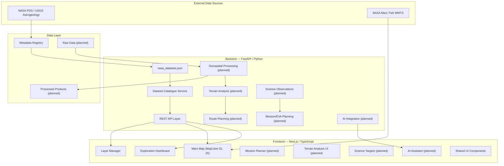

# MARS-X Architecture Overview

> System architecture for the Mars Terrain Intelligence and Astronaut Marswalk Planning Platform.

---

## System Architecture Diagram



---

## Backend Modules

The backend is built with **FastAPI** and follows a modular service architecture.

### Implemented

| Module | Path | Description |
|---|---|---|
| **API Layer** | `app/main.py`, `app/routers/` | FastAPI application with CORS, health endpoints, and dataset routes |
| **Configuration** | `app/config.py` | Environment-based settings (APP_NAME, VERSION, CORS_ORIGINS) |
| **Models** | `app/models/` | Pydantic schemas for health responses and dataset metadata |
| **Dataset Catalogue** | `app/services/dataset_catalogue.py` | Loads and serves the 11-source NASA dataset registry |
| **Static Data** | `app/data/nasa_datasets.json` | JSON catalogue of registered Mars datasets |

### Planned

| Module | Purpose |
|---|---|
| **Geospatial Processing** | Rasterio/GDAL pipeline for Mars raster data (DTMs, imagery) |
| **Terrain Analysis** | Elevation profiles, slope/aspect calculation, hazard assessment |
| **Route Planning** | Astronaut marswalk traverse optimisation with terrain constraints |
| **Science Observations** | Management of science targets and point-of-interest annotations |
| **Mission/EVA Planning** | Timeline generation, resource budgets, traverse scheduling |
| **AI Integration** | LLM-based exploration recommendations and data summarisation |

---

## Frontend Modules

The frontend is built with **Next.js 15**, **TypeScript**, and **Tailwind CSS** with a dark space/Mars aesthetic.

### Implemented

| Module | Path | Description |
|---|---|---|
| **Mars Map** | `components/map/` | MapLibre GL JS map with Mars tile layers |
| **Layer Manager** | `components/layers/` | Toggle and configure map data layers |
| **Exploration Dashboard** | `components/dashboard/` | Overview panels showing status, datasets, and system health |
| **Shared UI** | `components/ui/` | Reusable buttons, cards, status indicators, and layout components |

### Planned

| Module | Purpose |
|---|---|
| **Mission Planner** | EVA timeline creation and traverse planning interface |
| **Terrain Analysis** | Elevation profile viewer, slope analysis overlays |
| **Science Targets** | Point-of-interest management and annotation tools |
| **AI Assistant** | Conversational interface for exploration queries |

---

## Data Flow

```
NASA PDS / USGS
      │
      ▼
  Metadata Registry (nasa_datasets_reference.json)
      │
      ▼
  Dataset Catalogue Service (loads nasa_datasets.json)
      │
      ▼
  REST API (GET /api/v1/datasets)
      │
      ▼
  Frontend Dashboard / Layer Manager
```

### Current State

1. **Metadata only** — The catalogue contains metadata for 11 NASA/USGS datasets. No raw data has been downloaded.
2. **All datasets have `processing_status: "registered"`** — They exist in the registry but have not been fetched, validated, or processed.
3. **No fabricated data** — Every dataset entry references real NASA/USGS sources with accurate URLs and metadata.

### Future Pipeline (planned)

```
Download → Validate → Process → Serve
  │          │           │         │
  │          │           │         └─ Tile server / API endpoints
  │          │           └─ Rasterio/GDAL transforms, CRS reprojection
  │          └─ Schema validation, checksum verification
  └─ Automated retrieval from PDS/USGS archives
```

---

## Technology Decisions

| Decision | Choice | Rationale |
|---|---|---|
| Backend framework | FastAPI | Async-first, automatic OpenAPI docs, Pydantic integration |
| Frontend framework | Next.js 15 (App Router) | Server components, file-based routing, React 18 streaming |
| Map library | MapLibre GL JS | Open-source, WebGL rendering, custom tile source support |
| Styling | Tailwind CSS | Utility-first, dark theme support, consistent design system |
| Dataset storage | JSON registry | Simple to start; can migrate to database when scale demands it |
| Schema validation | JSON Schema (Draft 2020-12) | Language-agnostic, used by both Python backend and standalone validator |
| Language | TypeScript (frontend), Python (backend) | Type safety, ecosystem maturity, scientific Python libraries |

---

## Mars CRS Architecture

> [!WARNING]
> Mars coordinates use **EPSG:104905** (IAU 2000 Mars), not EPSG:3857 (Web Mercator).

### Coordinate Reference System

- **EPSG:104905** — IAU 2000 Mars aerographic coordinate system
- **IAU:49900** — Equivalent IAU identifier for Mars geographic CRS
- Mars radius: 3,396.19 km (equatorial), 3,376.20 km (polar)

### Shaded Relief vs. Numerical DTM

These are distinct data products and must be kept separate:

| Product | Purpose | Use Case |
|---|---|---|
| **Shaded relief** | Visual representation of terrain | Map background imagery — rendered hillshade for visual context |
| **Numerical DTM** | Quantitative elevation values | Terrain analysis — slope, aspect, elevation profiles, route planning |

Mixing them (e.g., reading pixel values from a shaded relief as elevations) produces scientifically meaningless results.

### MapLibre Limitations

MapLibre GL JS natively supports only **EPSG:3857** (Web Mercator). Options for Mars CRS support:

1. **Server-side reprojection** — Reproject Mars tiles to 3857 on the backend before serving *(simplest, loses projection accuracy)*
2. **Custom projection with proj4js** — Add Mars CRS definition to proj4 and transform on the client *(more accurate, more complex)*
3. **maplibre-rs / fork** — Future native non-3857 support in MapLibre *(not yet available)*

See [CRS Projection Notes](../research/crs_projection_notes.md) for full analysis.
