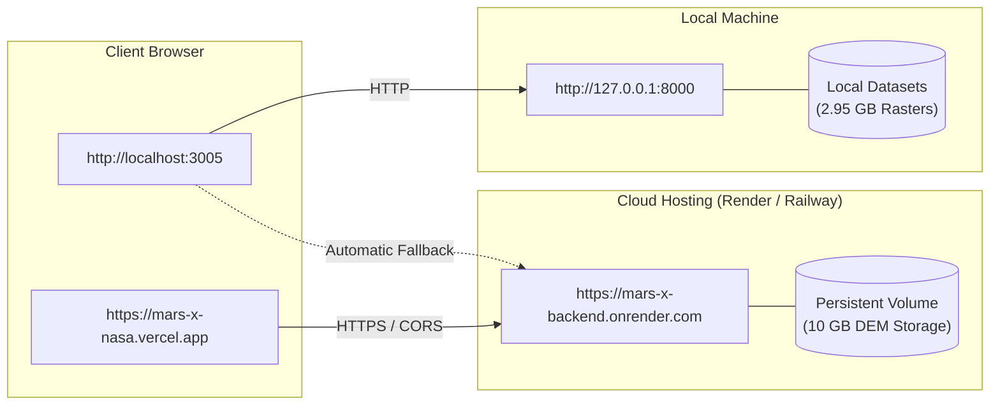

# MARS-X — Production Deployment & Environment Integration Guide

**Platform:** MARS-X — Interplanetary Survival Guide: Martian Map  
**Frontend Deployment:** Vercel (`https://mars-x-nasa.vercel.app`)  
**Backend Deployment:** Render / Railway (`https://mars-x-backend.onrender.com`)  
**Local Development:** Frontend on `http://localhost:3005`, Backend on `http://127.0.0.1:8000`

---

## 1. Overview & Architecture

MARS-X operates as a decoupled full-stack geospatial architecture:
- **Client (Next.js 16 / React 19):** Static & client-side rendered dashboard deployed to **Vercel** with WebGL / MapLibre planetary canvas.
- **Engine (FastAPI / Python 3.12):** RESTful geospatial and climatological calculation engine deployed to **Render** (or **Railway**), accessing authentic planetary datasets and numerical rasters.



---

## 2. Vercel Frontend Environment Configuration

In the [Vercel Project Dashboard](https://vercel.com/):
1. Navigate to **Settings** → **Environment Variables**.
2. Add the following environment variables for **Production**, **Preview**, and **Development**:

| Variable Name | Required Value | Purpose |
|---|---|---|
| `NEXT_PUBLIC_API_URL` | `https://mars-x-backend.onrender.com` | Primary HTTPS backend base URL |
| `NEXT_PUBLIC_API_BASE_URL` | `https://mars-x-backend.onrender.com` | Alias supported for backward compatibility |

> [!IMPORTANT]
> - Never set `NEXT_PUBLIC_API_URL` to `http://localhost:8000` in Vercel.
> - The client automatically strips any trailing slashes (`/`).
> - If `NEXT_PUBLIC_API_URL` is omitted on Vercel, the client automatically defaults to `https://mars-x-backend.onrender.com` in production browser environments.

---

## 3. Backend Hosting Setup (Render & Railway)

### A. Render Configuration (`render.yaml`)

MARS-X includes an Infrastructure-as-Code manifest ([`render.yaml`](../../render.yaml)):

```yaml
services:
  - type: web
    name: mars-x-backend
    runtime: python
    region: oregon
    plan: standard
    buildCommand: "pip install -r backend/requirements.txt"
    startCommand: "uvicorn app.main:app --app-dir backend --host 0.0.0.0 --port $PORT"
    healthCheckPath: /health
    envVars:
      - key: APP_NAME
        value: MARS-X
      - key: CORS_ORIGINS
        value: "https://mars-x-nasa.vercel.app,http://localhost:3005,http://127.0.0.1:3005,https://mars-x-backend.onrender.com"
      - key: PYTHON_VERSION
        value: "3.12.6"
    disk:
      name: mars-data
      mountPath: /opt/render/project/src/data
      sizeGB: 10
```

### B. Manual Service Settings (Render UI)

If configuring via the Render Dashboard:
- **Repository:** `https://github.com/iamasifroshan/MARS-X.git`
- **Branch:** `main` *(or `master` if tracking master)*
- **Root Directory:** *(leave blank — repository root)*
- **Runtime:** `Python 3`
- **Build Command:** `pip install -r backend/requirements.txt`
- **Start Command:** `uvicorn app.main:app --app-dir backend --host 0.0.0.0 --port $PORT`
- **Health Check Path:** `/health`

---

## 4. CORS Configuration

Per W3C specifications, when `allow_credentials=True` is enabled, the wildcard origin `*` is strictly forbidden. The MARS-X backend enforces an explicit whitelist:

```python
# backend/app/config.py
DEFAULT_CORS_ORIGINS = [
    "https://mars-x-nasa.vercel.app",       # Vercel Production
    "https://mars-x-backend.onrender.com",  # Render Production
    "http://localhost:3005",                # Local Next.js (Default)
    "http://127.0.0.1:3005",
    "http://localhost:3000",
    "http://127.0.0.1:3000",
    "http://localhost:3001",
    "http://127.0.0.1:3001",
    "http://localhost:4000",
    "http://127.0.0.1:4000",
]
```

To permit preview branches dynamically (e.g. `https://mars-x-nasa-git-feat.vercel.app`), `CORSMiddleware` also includes `allow_origin_regex`:
```python
allow_origin_regex = r"^https?://(localhost|127\.0\.0\.1|(?:[a-zA-Z0-9-]+\.)*onrender\.com|(?:[a-zA-Z0-9-]+\.)*vercel\.app)(:[0-9]+)?$"
```

---

## 5. Dataset Storage Requirements & Hosting Limits

### Dataset Allocation Matrix

| Component | Format | Location | Storage Type | Size | Present in Git? |
|---|---|---|---|---|---|
| **MCD v6.2 Climatology** | JSON / NetCDF | `data/originals/climatology/` | In-repo | ~4.2 MB | **Yes** |
| **MEDA Sol 1 Weather** | CSV | `data/environmental/meda/` | In-repo | ~250 KB | **Yes** |
| **REMS Sol 1 Weather** | CSV | `data/environmental/rems/` | In-repo | ~180 KB | **Yes** |
| **Science Discoveries** | JSON | `data/metadata/` | In-repo | ~120 KB | **Yes** |
| **MOLA MEGDR 128 ppd** | Float32 GeoTIFF | `data/processed/mola/` | Persistent Disk | ~228 MB | No (Gitignored) |
| **CTX Stereo DTMs (20m)**| Float32 GeoTIFF | `data/raw/ctx/`, `data/originals/ctx/` | Persistent Disk | ~60 MB | No (Gitignored) |
| **HiRISE DTM (1m)** | Float32 GeoTIFF | `data/originals/hirise/` | Persistent Disk | ~10 MB | No (Gitignored) |
| **MGS TES Thermal Inertia**| GeoTIFF | `data/tes/` | Persistent Disk | ~25 MB | No (Gitignored) |
| **USGS SIM 3292 Geology** | Shapefiles | `data/geology/` | Persistent Disk | ~1.8 GB | No (Gitignored) |

### Hosting Recommendations
1. **Cloud-Native Operation Without Disks:**
   - Analytical atmospheric pressure models (`/api/v1/environmental/pressure/estimate`).
   - Deterministic solar geometry & irradiance (`/api/v1/environmental/solar-geometry`).
   - Mars Equation of Time & time systems (`/api/v1/environmental/time/*`).
   - In-situ rover observations (`/api/v1/environmental/historical/*`).
   - Mars Climate Database v6.2 seasonal & diurnal curves (`/api/v1/environmental/climatology/*`).
   - Candidate Science Discoveries catalogue (`/api/v1/discovery/*`).
   - Dataset Provenance Registry (`/api/v1/science/provenance`).
2. **Persistent Volume Requirement for Full Rasters:**
   - For high-resolution terrain profiling (`/api/v1/terrain/elevation/profile`) and A* pathfinding (`/api/v1/marswalk/route`), attach a **10 GB persistent disk** on Render or Railway mounted at `/opt/render/project/src/data`.
   - When a requested raster is not present on disk, the backend returns a clear `HTTP 503 Service Unavailable` explaining the storage requirement, preventing unhandled server crashes.

---

## 6. Verification Checklist

Run these commands to verify deployment health:

```bash
# 1. Verify health check on production backend
curl -i https://mars-x-backend.onrender.com/health

# 2. Verify CORS preflight for Vercel production origin
curl -i -X OPTIONS https://mars-x-backend.onrender.com/health \
  -H "Origin: https://mars-x-nasa.vercel.app" \
  -H "Access-Control-Request-Method: GET"

# Expected Header in Response:
# access-control-allow-origin: https://mars-x-nasa.vercel.app
# access-control-allow-credentials: true

# 3. Verify core scientific endpoints
node scripts/test_deployed_backend.mjs
```
