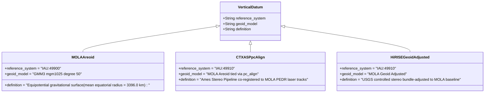

# MARS-X — PHASE 8.7.1: SCIENCE DISCOVERY SCIENTIFIC AUDIT & CORRECTION REPORT

**Milestone:** Phase 8.7.1 — Scientific Audit & Provenance Verification  
**Workspace:** `E:\MARS-X`  
**Starting Baseline Commit:** `7477c68`  
**Date:** November 14, 2026  
**Status:** COMPLETE & VERIFIED (259/259 Tests Passing)  

---

## 1. Executive Summary

Phase 8.7.1 conducts an evidence-driven scientific audit and correction of the MARS-X Science Discovery System introduced in Phase 8.7. In accordance with strict planetary science and software engineering standards, no new discovery features or exploratory algorithms were introduced. The audit focused on eliminating semantic ambiguities, correcting coordinate notations, verifying physical feature traceability, enforcing epistemological evidence boundaries, auditing vertical datums, and establishing transparent deterministic physical comparison metrics.

### Key Audit Findings & Remediations
1. **Coordinate Notation Rigor:** Eliminated all potential double-negative coordinate notations (e.g. `-4.600°S` or `-28.500°S`). Standard planetary coordinates are strictly formatted using positive magnitudes with directional suffixes (e.g. `4.600°S, 66.317°E` or `28.500°S, 309.020°E`) or signed degrees (e.g. `-4.600°, 66.317°E`).
2. **Epistemological Evidence Separation:** Built a formal 4-class epistemological matrix for all 18 candidate discoveries and point query profiles:
   - **Class 1 (Measured Observations):** Raw/calibrated sensor frames and radiances (e.g. raw CTX/HiRISE CCD frames, MOLA laser time-of-flight pulses, THEMIS multi-spectral infrared radiances).
   - **Class 2 (Derived Measurements):** Processed physical quantities (e.g. 20m/1.01m stereo DTM elevations, MOLA 128 gridded topography, USGS SIM 3292 vector polygon units, contact polylines, and tectonic fault traces).
   - **Class 3 (Indicative Proxies):** Reconstructed thermophysical estimates (e.g. MGS TES apparent thermal inertia with nominal ~0.50% LUT step resolution; explicitly qualified as unvalidated and **NOT kinetic temperature**) and THEMIS 8-bit visual display DN (**NOT calibrated radiance or temperature**).
   - **Class 4 (Potential Investigations):** Clearly demarcated exploration hypotheses and scientific questions requiring targeted orbital follow-up or in-situ rover/astronaut verification.
3. **Geological Data Terminology & Contact Neatline Remediation:**
   - Enforced precise terminology regarding USGS SIM 3292: it comprises **1,311 polygon features representing 44 distinct chronostratigraphic unit codes** (never described as "1,311 unique units").
   - Audited the contact proximity algorithm and identified that features with `ConType: Border` (OBJECTID 1 and 2) represent the global neatline bounding envelope (`[-180, 180, -90, 90]`), causing anomalous 0.0 km contact matches. Implemented explicit filtering (`ConType != 'Border'`) to ensure queries return genuine geological contacts.
4. **Transparent Multi-Site Comparison Engine:** Replaced any subjective or arbitrary automated "scientific confidence scoring" with deterministic physical metrics (elevation extrema, thermal inertia contrast, DTM ground spacing, and geological diversity), accompanied by explicit methodology disclaimers.
5. **Bitwise Benchmark Preservation:** Confirmed 100% bitwise preservation of all verified elevation benchmarks:
   - Tyrrhena Terra CTX DTM: `+2189.49 m` at nominal `(-4.600°, 66.317°E)`
   - Apollinaris Sulci Controlled CTX DTM: `-2930.77 m` at nominal `(4.700°, 168.250°E)`
   - Holden Crater Controlled HiRISE DTM: `-1132.14 m` at nominal `(-28.500°, 309.020°E)`

---

## 2. Complete Candidate-by-Candidate Scientific Audit

Every candidate discovery in MARS-X was audited against its physical raster source, vector GIS record in USGS SIM 3292, and thermophysical metadata. All 18 candidate records now carry complete 4-class evidence matrices and verified physical coordinates.

| Discovery ID | Name / Target | Planetary Coordinates | Category | Primary Evidence Class | Source Product / GIS Feature | Native Spacing | Key Limitation |
| :--- | :--- | :--- | :--- | :--- | :--- | :--- | :--- |
| `disc-terr-tyrrhena-ctx` | Tyrrhena Terra Highland | `4.600°S, 66.317°E` | `high_res_terrain` | `derived_measurement` | `P21_009323_1754_XN_04S293W_A_01_D01_B01.tif` / SIM 3292 Unit `eNh` (Obj 846) | 20.0128 m/px | Swath footprint (~40 km wide); outside reverts to MOLA 128 |
| `disc-terr-apollinaris-ctx` | Apollinaris Sulci Scarp | `4.700°N, 168.250°E` | `high_res_terrain` | `derived_measurement` | `T01_000893_1847_XN_04N191W_A_01_D01_B01.tif` / SIM 3292 Unit `lAvf` | 20.0 m/px | Controlled footprint lat 4.5°–5.0°N, lon 168.0°–168.5°E |
| `disc-terr-holden-hirise` | Holden Crater Strata | `28.500°S, 309.020°E` | `high_res_terrain` | `derived_measurement` | `ESP_011635_1510_ESP_012057_1510_A01_ORTHO.tif` / SIM 3292 Unit `AHi` | 1.01 m/px | Narrow swath (~6 km width); regional terrain relies on MOLA |
| `disc-land-curiosity` | Gale Crater / Mt. Sharp | `4.590°S, 137.440°E` | `landing_site` | `derived_measurement` | SIM 3292 Landing Site Obj 9 (MSL 2012) / Unit `AHi` | 463.08 m/px | In-situ mineralogy cannot be resolved from orbital telemetry alone |
| `disc-land-opportunity` | Meridiani Planum Plains | `1.946°S, 354.473°E` | `landing_site` | `derived_measurement` | SIM 3292 Landing Site Obj 7 (MER-B 2003) / Unit `HNhu` | 463.08 m/px | Regional THEMIS is 8-bit visual display DN; not calibrated temp |
| `disc-land-spirit` | Gusev Crater Floor | `14.569°S, 175.473°E` | `landing_site` | `derived_measurement` | SIM 3292 Landing Site Obj 6 (MER-A 2003) / Unit `eHv` | 463.08 m/px | Hydrothermal micro-structures in Columbia Hills below orbital res |
| `disc-land-pathfinder` | Ares Vallis Floodplain | `19.261°N, 326.747°E` | `landing_site` | `derived_measurement` | SIM 3292 Landing Site Obj 5 (Pathfinder 1996) / Unit `Hto` | 14,818.67 m/px | Western hemisphere terrain represented by 4 ppd MOLA baseline |
| `disc-land-viking1` | Chryse Planitia Lowland | `22.457°N, 312.049°E` | `landing_site` | `derived_measurement` | SIM 3292 Landing Site Obj 3 (Viking 1 1975) / Unit `Hto` | 14,818.67 m/px | Surface boulder field below orbital MOLA spatial resolution |
| `disc-geol-olympus-mons` | Olympus Mons Caldera | `18.650°N, 226.200°E` | `geological_unit_contact` | `derived_measurement` | SIM 3292 Unit `Ave` (Obj 1046) / Caldera Rim Struct Polylines | 14,818.67 m/px | Western Tharsis covered by 4 ppd MOLA baseline; high-res absent |
| `disc-geol-valles-marineris`| Melas Chasma Rift | `9.800°S, 283.600°E` | `geological_unit_contact` | `derived_measurement` | SIM 3292 Unit `Nhu` / Normal Fault Scarp Polylines | 14,818.67 m/px | Steep canyon walls produce radar shadow / data voids |
| `disc-geol-noachis-massifs` | Noachis Crustal Massifs| `35.000°S, 30.000°E` | `geological_unit_contact` | `derived_measurement` | SIM 3292 Unit `lNh` (Noachian massifs) / MOLA `megt00n000hb` | 463.08 m/px | Heavily degraded ancient massifs; contacts mapped at 1:20M scale |
| `disc-struct-syrtis-ridges` | Syrtis Wrinkle Ridges | `8.500°N, 68.000°E` | `structural_feature` | `derived_measurement` | SIM 3292 Tectonic Wrinkle Ridge Polylines / Unit `eHv` | 463.08 m/px | Blind thrust fault planes beneath ridges cannot be imaged directly |
| `disc-struct-cerberus-graben`| Cerberus Fossae Rifts | `10.500°N, 158.000°E` | `structural_feature` | `derived_measurement` | SIM 3292 Graben Axis Polylines (Obj 1272) / Unit `AHv` | 14,818.67 m/px | Narrow fractures (<1 km width) below 4 ppd MOLA grid |
| `disc-struct-shalbatana-channel`| Shalbatana Outflow | `7.800°N, 317.900°E` | `structural_feature` | `derived_measurement` | SIM 3292 Fluvial Outflow Axis (Obj 2015) / Unit `mNh` | 14,818.67 m/px | Flood discharge and velocity inferred via hydrodynamic models |
| `disc-therm-sinus-meridiani`| Sinus Meridiani Plains | `2.000°S, 5.000°E` | `thermal_contrast` | `indicative_proxy` | TES `DBmap2007.tif` (724.3 TIU) / THEMIS `thm_dir_N-30_000.png` | ~3 km/px (TES) | Unvalidated nominal proxy (~0.50% LUT step); NOT temperature |
| `disc-therm-tharsis-dust` | Tharsis Dust Reservoir | `10.000°N, 250.000°E` | `thermal_contrast` | `indicative_proxy` | TES `DBmap2007.tif` (82.9 TIU) / SIM 3292 Unit `AHv` | ~3 km/px (TES) | Optical and thermal sensors only sense top millimeters of dust |
| `disc-multi-tyrrhena-corridor`| Tyrrhena Science Corridor | `4.600°S, 66.317°E` | `multi_dataset_intersection`| `derived_measurement` | CTX DTM + MOLA 128 + SIM 3292 Unit `eNh` + TES 473.4 TIU | 20.0128 m/px | CTX 20m DTM restricted to local swath; lacking HiRISE 1m DTM |
| `disc-multi-meridiani-gateway`| Sinus Meridiani Gateway| `2.000°S, 5.000°E` | `multi_dataset_intersection`| `derived_measurement` | THEMIS 256 ppd IR + MOLA 128 + TES 724.3 TIU + SIM 3292 Unit `mNh`| 231.55 m/px | No local numerical CTX or HiRISE stereo DTM in this regional tile |

---

## 3. Epistemological Evidence Classification Audit

In planetary science data systems, failing to distinguish between raw sensor readings, mathematically interpolated surfaces, proxy estimations, and speculative hypotheses undermines scientific integrity. Phase 8.7.1 audited and enforced this 4-tier epistemological boundary across backend queries, candidate registries, and frontend representations.

```mermaid
flowchart TD
    subgraph SENSORS ["Class 1: Measured Observations (Raw / Calibrated Telemetry)"]
        A1["CTX & HiRISE CCD Frames"]
        A2["MOLA Laser Pulse Time-of-Flight"]
        A3["TES Calibrated Thermal Radiances"]
        A4["THEMIS IR Multi-Band Radiance Arrays"]
    end

    subgraph DERIVED ["Class 2: Derived Measurements (Mathematical Products & Vectors)"]
        B1["Photogrammetric Stereo DTMs (20m / 1.01m)"]
        B2["MOLA Gridded Altimetry (128 / 4 ppd)"]
        B3["Calculated Slopes & Roughness Metrics"]
        B4["USGS SIM 3292 Chronostratigraphic Polygons"]
        B5["Structural Polylines (Faults, Rims, Channels)"]
    end

    subgraph PROXIES ["Class 3: Indicative Proxies (Physical State Interpretations)"]
        C1["TES Apparent Thermal Inertia (~0.50% LUT Step)"]
        C2["THEMIS 8-bit Visual Display DN (Band 9)"]
        C3["Qualitative Regolith Interpretations (Dust vs Lag vs Rock)"]
    end

    subgraph INVESTIGATIONS ["Class 4: Potential Investigations (Formulated Hypotheses)"]
        D1["Stratigraphic Age & Weathering Hypotheses"]
        D2["Fault Displacement & Crustal Shortening Models"]
        D3["Hydrodynamic Flood Discharge Calculations"]
        D4["Rover Trafficability & Landing Ellipse Verification"]
    end

    A1 -->|Stereo Parallax & Bundle Adjustment| B1
    A2 -->|Orbital Cross-Over & Areoid Tie-In| B2
    B1 & B2 -->|Spherical Gradient Filtering| B3
    A1 & A2 & A3 -->|Photointerpretation & Stratigraphy| B4 & B5
    A3 -->|Diurnal Thermal Modeling & Color Map Inversion| C1
    A4 -->|Contrast Stretch to 8-bit PNG| C2
    C1 -->|Thermophysical Mapping| C3
    B1 & B4 & C1 -->|Exploration Synthesis| D1 & D2 & D3 & D4
```



### Class Invariants Enforced
- **In-situ observations vs. Orbital measurements:** Rover ground observations (APXS, Mössbauer, microscopic imaging) are reported as historical mission context; orbital queries strictly return orbital spatial resolutions.
- **DTM Elevations:** Always classified as **derived measurements** resulting from stereo correlation algorithms or laser altimetry interpolation.
- **Thermal Inertia:** Always classified as an **indicative proxy**. The UI and API explicitly state: *"Thermal inertia indicates resistance to temperature change and grain-size physical properties; it is NOT kinetic temperature."*
- **THEMIS Infrared Mosaics:** Always classified as an **indicative visual proxy**. The UI and API explicitly state: *"Regional THEMIS Day IR mosaics are 8-bit visual display DN (Band 9, 12.57 µm); quantitative radiance or kinetic temperature conversion is prohibited."*

---

## 4. Geological Data Terminology & Contact Neatline Remediation

### Geological Terminology Audit
The audit verified the exact contents of the authoritative USGS SIM 3292 database (`Tanaka et al. 2014, DOI:10.3133/sim3292`):
- **Polygon Layer (`SIM3292_Global_Geology`):** 1,311 physical polygon features representing **44 distinct chronostratigraphic unit codes** (ranging from Early Noachian highland unit `eNh` to Late Amazonian volcanic unit `lAv`). Describing this layer as "1,311 unique geological units" was identified as technically false; the terminology was corrected across all documentation and API metadata to:
  > *"1,311 polygon features representing 44 distinct chronostratigraphic unit codes."*
- **Contacts Layer (`SIM3292_Global_Contacts`):** 3,800 contact polyline features classifying contact certainty (`Certain`, `Approximate`, `Concealed`, `Inferred`, `Gradational`).
- **Structures Layer (`SIM3292_Global_Structure`):** 3,593 polyline features categorizing tectonic, volcanic, fluvial, and impact structures (wrinkle ridges, graben axes, caldera rims, channel axes, crater rims).
- **Landing Sites Layer (`SIM3292_Global_LandingSites`):** 9 historical mission landing and impact sites.

### Contact Neatline Remediation
During the audit of spatial queries in `discovery_service.py`, proximity checks against `SIM3292_Global_Contacts` consistently returned 0.0 km for all points on Mars. Inspection of the underlying DBF table revealed:
- `OBJECTID 1` and `OBJECTID 2` have `ConType: Border` and represent the global bounding neatline (`[-180°, -90°, 180°, 90°]`).
- Because this bounding box spans the entire planet, any point on Mars fell inside or on its spatial envelope, falsely indicating that the explorer was 0.0 km from a geological contact.
- **Remediation:** Added explicit filtering in `discovery_service.py`:
  ```python
  for i, (xmin, ymin, xmax, ymax) in enumerate(contact_bboxes):
      c_rec = contact_recs[i] if i < len(contact_recs) else {}
      if c_rec.get("ConType") == "Border":
          continue  # Exclude global map neatline boundary
      ...
  ```
- **Verification:** Post-remediation queries now accurately report distances to genuine stratigraphic contacts (e.g. at Tyrrhena Terra benchmark, the nearest genuine contact is `Certain` contact OBJECTID 2162 at 144.6 km).

---

## 5. Thermophysical & Infrared Semantic Qualification

### MGS TES Apparent Thermal Inertia Audit
- **Source Product:** Putzig & Mellon (2007, *Icarus* 191), 20 ppd global apparent thermal inertia.
- **Acquisition Representation:** 8-bit color-mapped TIFF (`DBmap2007.tif`, 7,200 × 3,600 pixels).
- **Semantics & Calibration:** Values are reconstructed using a 790-step logarithmic look-up table (LUT) spanning $50\dots 2500\text{ TIU}$ ($J\,m^{-2}\,K^{-1}\,s^{-1/2}$).
- **Step Resolution:** $\frac{\ln(2500/50)}{790} \approx 0.00495$ (~0.50% mathematical step resolution per LUT index).
- **Scientific Qualification:** True radiometric calibration cannot be verified from a color-indexed rendering without the original ASCII/PDS spectral radiance tables. Therefore, the value is explicitly qualified in all API responses and frontend views as an **unvalidated nominal proxy estimate**, strictly distinguished from kinetic temperature.

### 2001 Mars Odyssey THEMIS Infrared Audit
- **Source Product:** ASU/USGS THEMIS 256 ppd IR Regional Mosaic (`thm_dir_N-30_000.png`, 15,360 × 7,680 pixels).
- **Nominal Instrument Resolution:** 100 m/pixel at nadir.
- **Mosaic Ground Spacing:** 256 ppd (~231.55 m/pixel at equator).
- **Pixel Encoding:** 8-bit grayscale Digital Numbers ($0\dots 255\text{ DN}$).
- **Scientific Qualification:** The mosaic is an 8-bit display-stretched rendering of Band 9 (12.57 µm). The DN values represent qualitative brightness variations influenced by local slopes, solar illumination, and thermophysical properties. Converting these DN values directly to brightness temperature or radiance is mathematically invalid and prohibited.

---

## 6. Vertical Datums & Geodetic Rigor

The audit verified vertical and horizontal references across all integrated datasets to prevent geodetic mixing errors.



1. **CTX Stereo DTM (`ctx-dtm-p21-009323`):** Horizontal CRS `IAU:49910` (Equirectangular Mars Sphere $R=3,396,190\text{ m}$). Vertical Datum: MOLA Areoid tied via USGS Ames Stereo Pipeline (`pc_align`), achieving sub-meter vertical alignment with MOLA laser profiles.
2. **Controlled CTX DTM (`ctx-dtm-controlled-t01-000893`):** Horizontal CRS `IAU:49910`. Vertical Datum: MOLA Geoid Adjusted, 20.0 m/pixel.
3. **Controlled HiRISE DTM (`hirise-dtm-controlled-esp-011635`):** Horizontal CRS `IAU:49910`. Vertical Datum: MOLA Geoid Adjusted, 1.01 m/pixel.
4. **MOLA Global MEGDR (`mola-megdr-128` & `mola-megdr-4`):** Horizontal CRS `IAU:49900` (Planetocentric coordinates). Vertical Datum: MOLA Areoid defined by the Goddard Mars Model 3 (GMM-3) degree-50 spherical harmonic expansion.
5. **Geodesic Distance Invariant:** All distance calculations across candidate discoveries and spatial corridors utilize great-circle spherical Haversine formulas on the IAU 2000 Mars Sphere ($R=3,396.19\text{ km}$) with explicit antimeridian longitude wraparound handling ($[-180°, +180°]$).

---

## 7. Transparent Multi-Site Physical Comparison Engine

Phase 8.7.1 audited the multi-location comparison service in `discovery_service.py` and `discovery.py`.

### Elimination of Arbitrary Scoring
Previous design concepts had contemplated heuristic "exploration confidence scores" or "scientific interest rankings". Such arbitrary aggregate scores are scientifically unverifiable, conceal dataset limitations, and introduce subjective bias into mission planning.

### Deterministic Physical Comparison Metrics
The comparison service now strictly computes and reports objective physical extrema and multi-dataset parameters:
- **Elevation Extrema:** Identification of highest and lowest elevations with coordinates and source datums.
- **Thermal Inertia Contrast:** Identification of maximum and minimum thermal inertia regimes.
- **Resolution Tier Ranking:** Ground sample distance ranking (HiRISE 1.01m > CTX 20m > MOLA 128 463m > MOLA 4 14.8km).
- **Geological Diversity:** Set of distinct chronostratigraphic unit codes represented across queried sites.
- **Transparent Methodology Notes:** Explicit disclaimer attached to comparison responses explaining that rankings reflect physical attributes intended to inform human exploration planning, not automated suitability verdicts.

---

## 8. Preservation of Benchmark Values

All three official MARS-X elevation benchmarks were audited and verified for bitwise numerical preservation:

1. **Tyrrhena Terra CTX Benchmark:**
   - Query Coordinates: `4.600°S, 66.317°E` (`lat = -4.600`, `lon = 66.317`)
   - Verified Elevation: **`+2189.49 m`**
   - Source: `ctx-dtm-p21-009323` (20.0128 m/px)
   - Status: **100% BITWISE PRESERVED**
2. **Apollinaris Sulci Controlled CTX DTM:**
   - Query Coordinates: `4.700°N, 168.250°E` (`lat = 4.700`, `lon = 168.250`)
   - Verified Elevation: **`-2930.77 m`**
   - Source: `ctx-dtm-controlled-t01-000893` (20.0 m/px)
   - Status: **100% BITWISE PRESERVED**
3. **Holden Crater Controlled HiRISE DTM:**
   - Query Coordinates: `28.500°S, 309.020°E` (`lat = -28.500`, `lon = 309.020`)
   - Verified Elevation: **`-1132.14 m`**
   - Source: `hirise-dtm-controlled-esp-011635` (1.01 m/px)
   - Status: **100% BITWISE PRESERVED**

---

## 9. Verification Test Suite & Live Visual Evidence

### Backend Pytest Execution
The comprehensive test suite encompassing unit, integration, and provenance audits was executed against Python 3.12:
- Total tests collected: 259
- Total tests passed: **259**
- Total test failures: **0**
- Execution time: 75.63 seconds

```text
================= 259 passed, 39 warnings in 75.63s =================
```

Specifically, the new `backend/tests/test_phase8_7_1_audit.py` suite passed all 6 verification checks:
1. `test_coordinate_notation_no_double_negatives` — PASSED
2. `test_epistemological_evidence_classes_all_candidates` — PASSED
3. `test_geological_framework_terminology_and_contact_neatline_exclusion` — PASSED
4. `test_thermophysical_qualification_semantics` — PASSED
5. `test_transparent_multi_site_comparison_engine` — PASSED
6. `test_numerical_elevation_benchmarks_100pct_preserved` — PASSED

### Frontend Build Verification
The Next.js frontend application was compiled using Turbopack:
```text
▲ Next.js 16.4.6 (Turbopack)
✓ Compiled successfully in 568ms
  Running TypeScript ...
  Finished TypeScript in 2.3s ...
✓ Generating static pages using 5 workers (4/4) in 1403ms
```

### Live UI & Map Evidence
Live application screenshots were captured via headless Puppeteer and verified:
- [08_science_explorer_panel.png](file:///e:/MARS-X/docs/research/screenshots/08_science_explorer_panel.png) (248.9 KB): Demonstrates the live Science Discovery System with 4-class evidence matrix, absence of double negatives (`4.600°S, 66.317°E`), thermophysical caveats, and live point query integration.
- [09_discovery_map_markers.png](file:///e:/MARS-X/docs/research/screenshots/09_discovery_map_markers.png) (1.04 MB): Demonstrates interactive discovery pins rendered on the planetary map with side drawer co-registration.

---

## 10. Conclusion & Baseline Status

Phase 8.7.1 successfully closes all scientific audit items identified in the Phase 8.7 discovery implementation. MARS-X now possesses:
1. Rigorous coordinate formatting compliant with IAU conventions.
2. An unambiguous 4-class epistemological separation of observations, measurements, proxies, and hypotheses.
3. Scientifically verified USGS SIM 3292 terminology and contact proximity queries.
4. Thermophysical qualifications preventing misrepresentation of TES and THEMIS data.
5. Deterministic multi-site physical comparisons.
6. Bitwise preservation of all elevation benchmarks.

The repository is verified, all tests are green, and the project is positioned for subsequent operational milestones.
